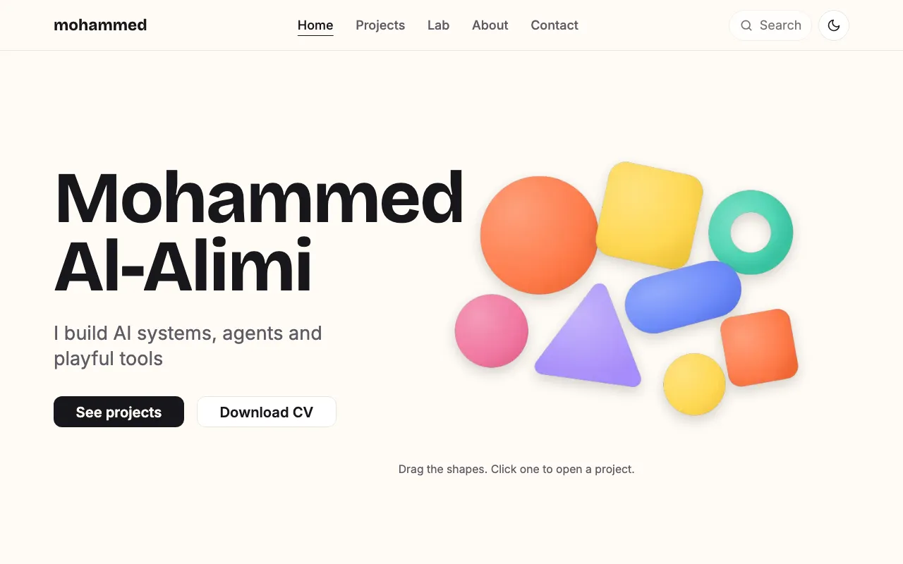

# Mohammed Al-Alimi, portfolio

Interactive, colourful, 3D-forward portfolio. Built with Next.js and a lot of small commits.

> Status: the foundation is shipped and live at <https://portfolio-mohammed-al-alimis-projects.vercel.app>. Home, Projects, seven project pages, Lab, About, a CV link, a nonce CSP and the quality gates are in place. The hero shows a static poster for now. The 3D scene, live data, search and the playground arrive in plans 2 to 5.

## What it will be

- A hero made of floating 3D shapes, one per project. Drag them, throw them, click one to open its case study.
- Case studies for shipped work: crowd detection thesis, Noah hub, the agent security playbook, Is My App Safe, and more.
- A live "Right now" panel with GitHub activity and a LeetCode streak.
- A Lab of small experiments and live demos.
- A visible Search, plus a hidden terminal for people who go looking.

## Principles

- Everyone can navigate it with the top bar and visible buttons. The playground is a side door, never the main path.
- Fast on phones. 3D is lazy-loaded and falls back to a static image on low-end devices.
- Adding a project is one content file. No CMS, no database.
- Security and documentation follow the [agent-security-playbook](https://github.com/MohammedAl-Alimi/agent-security-playbook) and the [documentation-playbook](https://github.com/MohammedAl-Alimi/documentation-playbook).

## Scripts you need

Use Node 24 (`nvm use`), then `npm ci`.

| Command | What it does |
| --- | --- |
| `npm run dev` | Start the dev server |
| `npm run test` | Unit tests |
| `npm run test:e2e` | End to end tests |
| `npm run validate:content` | Check all content files |
| `npm run check:secrets` | Scan for secrets before you push |

## Docs

Start at [`docs/README.md`](docs/README.md). It follows the Diátaxis structure:

- [Tutorials](docs/README.md#tutorials): none yet.
- [How-to guides](docs/README.md#how-to-guides): [run the site locally](docs/how-to/run-locally.md).
- [Reference](docs/README.md#reference): [project structure](docs/reference/project-structure.md), [content schema](docs/reference/content-schema.md), [configuration](docs/reference/configuration.md), [design tokens](docs/reference/design-tokens.md).
- [Explanation](docs/README.md#explanation): [architecture](docs/explanation/architecture.md), [security](docs/explanation/security.md).

## License

MIT for the code. Project content, images and copy are all rights reserved.
