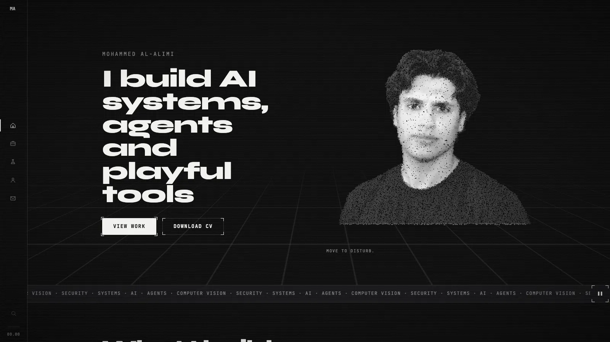

# Mohammed Al-Alimi, portfolio

Interactive, monochrome, 3D-forward portfolio. Built with Next.js and a lot of small commits.

> Status: the Monolith design is shipped and deployed to Vercel at <https://portfolio-mohammed-al-alimis-projects.vercel.app> (private until launch, the owner must be signed in to Vercel to view it). It includes:
> - The 3D point-cloud figure, which reacts to the pointer.
> - The rail on desktop and the bottom bar on phones.
> - Glitch page transitions and the crosshair cursor.
> - Home, Projects, seven project pages, the Lab with its figure sandbox, About, Contact and the CV link.
> - A nonce CSP and the quality gates.
>
> Live data, search and the playground arrive in later plans.

## What it will be

- A hero with a rotating grey point-cloud figure that reacts to the pointer, glitches now and then and has a scanline sweep.
- Case studies for shipped work: crowd detection thesis, Noah hub, the agent security playbook, Is My App Safe, and more.
- A live "Right now" panel with GitHub activity and a LeetCode streak.
- A Lab of small experiments and live demos.
- A visible Search, plus a hidden terminal for people who go looking.

## Principles

- Everyone can navigate it with the rail (or the bottom bar on phones) and visible buttons. The playground is a side door, never the main path.
- Fast on phones. 3D is lazy-loaded and falls back to a static image on low-end devices.
- Adding a project is one content file. No CMS, no database.
- Security and documentation follow the [agent-security-playbook](https://github.com/MohammedAl-Alimi/agent-security-playbook) and the [documentation-playbook](https://github.com/MohammedAl-Alimi/documentation-playbook).

## Scripts you need

Use Node 24 (`nvm use`), then `npm ci`.

| Command | What it does |
| --- | --- |
| `npm run dev` | Start the dev server |
| `npm run test` | Unit tests |
| `npm run test:e2e` | End to end tests |
| `npm run validate:content` | Check all content files |
| `npm run check:secrets` | Scan for secrets before you push |

## Docs

Start at [`docs/README.md`](docs/README.md). It follows the Diátaxis structure:

- [Tutorials](docs/README.md#tutorials): none yet.
- [How-to guides](docs/README.md#how-to-guides): [run the site locally](docs/how-to/run-locally.md), [regenerate the figure](docs/how-to/regenerate-the-figure.md).
- [Reference](docs/README.md#reference): [project structure](docs/reference/project-structure.md), [content schema](docs/reference/content-schema.md), [configuration](docs/reference/configuration.md), [design tokens](docs/reference/design-tokens.md), [figure format](docs/reference/figure-format.md).
- [Explanation](docs/README.md#explanation): [architecture](docs/explanation/architecture.md), [security](docs/explanation/security.md).

## License

MIT for the code. Project content, images and copy are all rights reserved.
