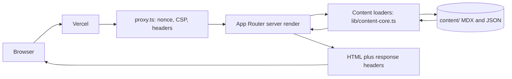
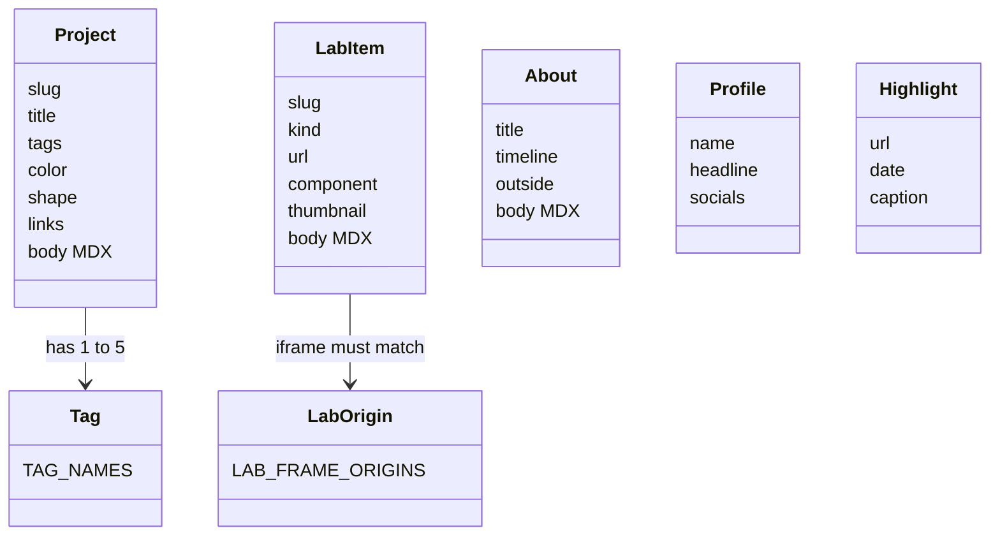

# Architecture

This page explains how the portfolio is put together and why. For exact names and values, see the [reference pages](../README.md#reference).

## The big picture

The site is a Next.js App Router app. Every page is a server component that reads local content files, validates them and renders HTML. A small `proxy.ts` runs in front of each page request to add a per request nonce, a Content Security Policy and other security headers.

The proxy is `proxy.ts:4`. The loaders are `lib/content-core.ts:84` and the functions after it. The root layout reads the nonce the proxy set (`app/layout.tsx:27`).

The content has a small, fixed shape. Each type has a Zod schema in `lib/schemas.ts`.

## Why content lives in files and is checked at build time

All text and data live in `content/`: MDX for long text, JSON for small records (`content/projects/`, `content/lab/`, `content/about.mdx`, `content/profile.json`, `content/highlights.json`). Adding a project is one new file. There is no CMS and no database, so there is nothing to host, patch or attack beyond the site itself.

Files can still be wrong, so every file is parsed by a strict Zod schema. A typo in a field name, a bad hex color or a missing cover image should stop the release, not show up as a broken page. Two layers do this:

- The `prebuild` script runs `scripts/validate-content.ts` before every build (`package.json:7`). It also checks things a schema cannot see, such as whether a cover file exists on disk (`scripts/validate-content.ts:22`).
- The loaders validate again whenever they read a file, and they throw with the file name and the failing field (`lib/content-core.ts:52`).

The schemas are strict objects, so an unknown field is rejected instead of being silently ignored (`lib/schemas.ts:36`). Components never hold copy of their own. They receive typed data from the loaders. That keeps the rule "content lives in `content/`" easy to check in review.

## Why pages are server components

Pages only read files and produce HTML. They need no browser APIs, so they run on the server and ship no data-fetching code to the visitor. Client components are used only where the browser is the point: the theme provider and toggle (`components/ui/ThemeProvider.tsx:1`), the mobile menu (`components/ui/MobileMenu.tsx:1`), the active nav link (`components/ui/NavLinks.tsx:1`) and the error boundaries.

The loaders are imported through `lib/content.ts`, which imports `server-only` (`lib/content.ts:1`). If a client component ever imports a loader, the build fails instead of bundling file system code for the browser.

## The persistent 3D canvas (upcoming)

This part is a plan from the design spec, not shipped code. Today the home page shows a static poster image (`components/home/HeroPoster.tsx:6`) and the sections reserve empty slots for later.

The plan, from `docs/superpowers/specs/2026-10-31-portfolio-design.md` (section "Persistent canvas"):

- Exactly one WebGL canvas, mounted once in the root layout and kept alive across client side route changes.
- Pages never create their own canvas. A page renders a drei `View` that claims a region of the page, and the scene for that region is drawn by the one canvas.
- The result is that a shape can travel from the home cluster into a project hero without a reload.
- Static HTML and the poster must render without any of it, so low end devices and reduced motion users get the same layout.

The slots already exist as marker attributes: `data-hero-slot` (`components/home/Hero.tsx:29`), `data-project-shape-slot` (`components/projects/ProjectHero.tsx:18`), `data-notfound-shape-slot` (`app/not-found.tsx:13`) and `data-lab-slot` (`app/lab/[slug]/page.tsx:44`). The rule "never add a second canvas" is written in `CLAUDE.md` under "Architecture guardrails".

## Why a nonce CSP in proxy.ts, and what it costs

A strict Content Security Policy limits where scripts can come from. With `'nonce-...'` and `'strict-dynamic'` (`lib/csp.ts:4`), only scripts that carry the right nonce, and the scripts they load, may run. Injected script tags fail. A static policy cannot do this, because the nonce must be different on every response.

A different value per response has a consequence. A page that depends on the request cannot be built once and served from a cache. The root layout reads the nonce from the request headers (`app/layout.tsx:27`), so every HTML route renders on demand. The build output marks `/`, `/projects`, `/projects/[slug]`, `/lab`, `/lab/[slug]` and `/about` as dynamic. Only `robots.txt`, `sitemap.xml` and the Open Graph images are prerendered.

The site accepts that cost for three reasons. The content is small and local, so rendering is fast. Security headers are the cheapest strong protection a static looking site can have. And Lighthouse is checked in CI against the real server (`lighthouserc.json:4`), so a slow page would fail a required check.

`style-src` keeps `'unsafe-inline'` (`lib/csp.ts:10`). The foundation plan records the reason: Next's font handling and inline `style` attributes need it (`docs/superpowers/plans/2026-10-31-portfolio-foundation.md:683`). Scripts, the higher risk, stay strict.

The same proxy shapes local runs: on plain `http://localhost` it drops `upgrade-insecure-requests`, because WebKit would otherwise upgrade subresources to https and break local and CI runs (`proxy.ts:6` to `proxy.ts:14`).

## Why cards use a stretched link

A project card shows an image, a title, a tagline, tags and a year. The whole card should be clickable, but wrapping everything in one anchor gives screen readers a very long link name, and it blocks any other interactive element inside.

`ProjectCard` uses a stretched link instead. The title is the only link. A pseudo element on it covers the whole card (`components/projects/ProjectCard.tsx:42`), and the card is `relative` so the cover stays inside it (`components/projects/ProjectCard.tsx:20`). The cover image has empty alt text because it is decorative (`components/projects/ProjectCard.tsx:26`). A keyboard user gets one tab stop with a clear name, and `focus-within` draws the outline around the card.

Simple cards with only text, such as the "What I build" cards, use the plain `Card` with an `href`, which wraps the card in a link (`components/ui/Card.tsx:36`).

## Why the playground is a side door

The design rule is: the normal site is for everyone, the playground is a side door. No public page depends on a shortcut, a gesture or a hidden feature (`docs/superpowers/specs/2026-10-31-portfolio-design.md`, section "Playground"). Anyone can reach every page with the top bar and visible buttons (`components/ui/Nav.tsx:13`, `lib/nav.ts:3`).

That is why the hero says "Drag the shapes. Click one to open a project." and the same projects are also in a plain grid on `/projects`, reached from the top bar or the "See projects" button (`components/home/Hero.tsx:32`, `components/home/Hero.tsx:20`). The 3D layer, search and terminal can add delight for people who look for it, and nobody is blocked if they do not.

## Further reading

- [Content schema](../reference/content-schema.md) for every field and loader.
- [Configuration](../reference/configuration.md) for the CSP directive list.
- [Security](security.md) for the full list of protections.
- [Project structure](../reference/project-structure.md) for where each file lives.
