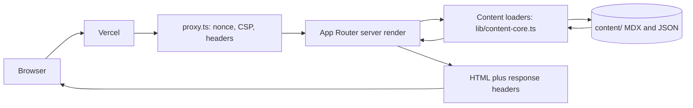
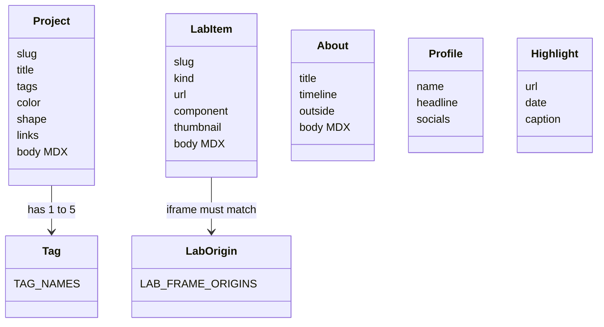
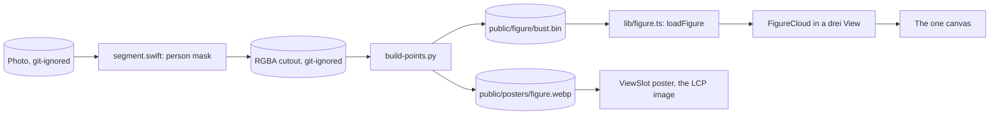

# Architecture

This page explains how the portfolio is put together and why. For exact names and values, see the [reference pages](../README.md#reference).

## The big picture

The site is a Next.js App Router app. Every page is a server component that reads local content files, validates them and renders HTML. A small `proxy.ts` runs in front of each page request to add a per request nonce, a Content Security Policy and other security headers.

The proxy is `proxy.ts:10`. The loaders are `lib/content-core.ts:86` and the functions after it. The root layout reads the nonce the proxy set (`app/layout.tsx:33`).

The content has a small, fixed shape. Each type has a Zod schema in `lib/schemas.ts`.

## Why content lives in files and is checked at build time

All text and data live in `content/`: MDX for long text, JSON for small records (`content/projects/`, `content/lab/`, `content/about.mdx`, `content/profile.json`, `content/highlights.json`). Adding a project is one new file. There is no CMS and no database, so there is nothing to host, patch or attack beyond the site itself.

Files can still be wrong, so every file is parsed by a strict Zod schema. A typo in a field name, a bad hex color or a missing cover image should stop the release, not show up as a broken page. Two layers do this:

- The `prebuild` script runs `scripts/validate-content.ts` before every build (`package.json:7`). It also checks things a schema cannot see, such as whether a cover file exists on disk (`scripts/validate-content.ts:24`).
- The loaders validate again whenever they read a file, and they throw with the file name and the failing field (`lib/content-core.ts:52`).

The schemas are strict objects, so an unknown field is rejected instead of being silently ignored (`lib/schemas.ts:36`). Components never hold copy of their own. They receive typed data from the loaders. That keeps the rule "content lives in `content/`" easy to check in review.

## Why pages are server components

Pages only read files and produce HTML. They need no browser APIs, so they run on the server and ship no data-fetching code to the visitor.

Client components appear only where the browser is the point:
- the transition provider and its links (`components/motion/TransitionProvider.tsx:1`)
- the active tab (`components/nav/TabLink.tsx:1`)
- the canvas loader (`components/three/CanvasRootLoader.tsx:1`)
- smooth scrolling (`components/motion/SmoothScroll.tsx:1`)
- the cursor (`components/motion/Crosshair.tsx:1`)
- the scene components they load

The site has one dark theme, so there is no theme provider. Its colour tokens are plain CSS variables in `app/globals.css:19`.

The loaders are imported through `lib/content.ts`, which imports `server-only` (`lib/content.ts:1`). If a client component ever imports a loader, the build fails instead of bundling file system code for the browser.

## The persistent 3D canvas

There is exactly one WebGL canvas. It is mounted once in the root layout (`app/layout.tsx:49`) and survives client side route changes. The rule "never add a second canvas" is in `CLAUDE.md` under "Architecture guardrails".

`CanvasRootLoader` decides the device tier first (`components/three/CanvasRootLoader.tsx:11`). It requests the 3D chunk only when the tier is `mid` or `high` and nothing has failed (`lib/scene-store.ts:51` to `lib/scene-store.ts:53`). The canvas itself is fixed behind the page at `z-index: -1`. It draws on demand, and only what drei's `View.Port` hands it (`components/three/CanvasRoot.tsx:14` to `components/three/CanvasRoot.tsx:28`). If WebGL loses its context, the store flips to failed and the posters come back (`components/three/CanvasRoot.tsx:23`).

Pages never touch the canvas. A page renders a `ViewSlot` with two children:
- a poster, in plain HTML, so it renders without JavaScript
- the scene (`components/three/ViewSlot.tsx:20`)

The scene mounts only while a canvas is active. After its first drawn frame it calls `useMarkReady` (`components/three/ready.ts:9`), and the poster fades out (`components/three/ViewSlot.tsx:29`). On the low tier, with reduced motion or without WebGL, the scene never mounts, so the visitor sees the same layout with the poster in place. The slots carry marker attributes: `data-hero-slot` (`components/home/Hero.tsx:42`), `data-project-shape-slot` (`components/projects/ProjectHero.tsx:18`), `data-notfound-shape-slot` (`components/three/StaticField.tsx:52`) and `data-lab-slot` (`app/lab/[slug]/page.tsx:45`).

## The figure pipeline

The hero figure is a point cloud built from one photo. The photo and its mask stay on the author's machine, in a git-ignored folder. Only the two derived files are committed. [How to regenerate the figure](../how-to/regenerate-the-figure.md) has the commands, and the [figure format reference](../reference/figure-format.md) has the byte layout.

The two scripts are dev tools and never run in CI. `build-points.py` writes the points and paints the poster from the same points, so the poster and the live figure line up. `FigureCloud` frames the cloud to match the poster (`lib/figure-fx.ts:118`).

In the browser, `HeroFigure` waits until the poster has loaded, or the browser is idle, before it fetches the 220 KB `bust.bin` (`components/home/HeroFigure.tsx:39`, `lib/after-poster.ts:5`). That keeps the fetch off the poster's path. `loadFigure` returns `null` on any failure, never an error, so a missing file leaves the poster in place (`lib/figure.ts:91`). Lower tiers draw a seeded subset of the points (`lib/figure.ts:58`).

The figure turns slowly. It reacts to the pointer, glitches every 6 to 10 seconds (`lib/figure-fx.ts:68`) and sweeps a scanline up the body every 4 seconds (`lib/figure-fx.ts:77`). On a CPU renderer or under reduced motion, it holds still (`components/three/FigureCloud.tsx:111`).

## The rail and the bottom bar

Navigation is one list (`lib/nav.ts:4`) drawn two ways. On wide screens it is the `Rail`: 72px wide and fixed on the left. It grows to 220px on hover or keyboard focus to show the labels (`components/nav/Rail.tsx:18`). Below 1024px it is the `TabBar`, fixed to the bottom and padded for the safe area (`components/nav/TabBar.tsx:13`). The layout offsets the content to match, with `lg:pl-[72px]` or bottom padding (`app/layout.tsx:51`).

Both bars mark the current page with `aria-current` and a 2px glow line through `TabLink` (`components/nav/TabLink.tsx:20`). The foot of the rail holds three things:
- the disabled search placeholder
- the cursor readout
- a scroll readout from `0.00` to `99.99`, fed by the one scroll feed in `lib/scroll.ts` (`components/nav/ScrollReadout.tsx:11`)

## Page transitions

`TransitionProvider` sits in the root layout and runs a small state machine: `idle`, then `covering` (200 ms), then the route change, then `uncovering` (200 ms), then `idle` (`components/motion/TransitionProvider.tsx:18` to `components/motion/TransitionProvider.tsx:36`). Every internal link is a `TransitionLink`. It hands plain left clicks to the provider and leaves modifier clicks, new tabs and external links to the browser (`components/motion/TransitionLink.tsx:16`).

`GlitchOverlay` animates the transition, and the provider drives it through a three-method handle: `cover`, `uncover` and `reset` (`components/motion/TransitionProvider.tsx:39` to `components/motion/TransitionProvider.tsx:44`).
- The overlay draws twelve sheared bands with the Web Animations API, so nothing ticks per frame in JavaScript (`components/motion/GlitchOverlay.tsx:6` to `components/motion/GlitchOverlay.tsx:16`).
- Under reduced motion it fades a single veil instead.
- Its root exposes `data-state`, which the e2e tests read (`components/motion/GlitchOverlay.tsx:135`).

A 1.5 s watchdog always returns the overlay to idle. Back and forward never animate. Focus moves to `#main` once the new page is in place.

## The cursor

`Crosshair` replaces the native cursor with a thin cross only when all four conditions hold (`components/motion/Crosshair.tsx:23`):
- a fine pointer that can hover
- a viewport at least 1024px wide
- the high tier
- no reduced motion

Over a link or a button, the cross turns into four brackets fitted to the target. While the page scrolls, the brackets follow the target's rect (`components/motion/Crosshair.tsx:157` to `components/motion/Crosshair.tsx:159`). After a route change, the cursor looks again at what is under the resting pointer (`components/motion/Crosshair.tsx:150`).

Each pointer move costs one `requestAnimationFrame`, and it writes only a transform and the rail readout, so React never re-renders. While the cursor runs, `<html data-cursor="custom">` hides the native cursor everywhere except text fields (`app/globals.css:52`).

## The halftone covers

Project covers are real images in greyscale, with a two-tone ordered dither drawn on a small canvas on top (`components/media/Halftone.tsx:25` to `components/media/Halftone.tsx:31`). The dither reads pixels from the image `next/image` already loaded, so the cover downloads once. It starts only when the card is near the viewport. The canvas stays hidden until it has drawn, so a failed load leaves the grey image. On the low tier there is no canvas (`components/media/Halftone.tsx:137`). On a project page, the same component draws the hero backdrop at 20% opacity (`components/projects/ProjectHero.tsx:24`).

## The static field

The 404 page shows the figure dissolved into static (`app/not-found.tsx:15`). A click reassembles it, and a second click scatters it again (`components/three/StaticField.tsx:20` to `components/three/StaticField.tsx:46`). The root `not-found` is part of every route's client bundle. So `StaticField` keeps to a button and a CSS-background poster, and it loads the scene and three.js only when a canvas is active (`components/three/StaticField.tsx:9` to `components/three/StaticField.tsx:13`). Without a canvas the poster sharpens instead, and `data-state` still flips, so the page works the same everywhere.

## Why a nonce CSP in proxy.ts, and what it costs

A strict Content Security Policy limits where scripts can come from. With `'nonce-...'` and `'strict-dynamic'` (`lib/csp.ts:4`), only scripts that carry the right nonce, and the scripts they load, may run. Injected script tags fail. A static policy cannot do this, because the nonce must be different on every response.

A different value per response has a consequence. A page that depends on the request cannot be built once and served from a cache. The root layout reads the nonce from the request headers (`app/layout.tsx:33`), so every HTML route renders on demand. The build output marks `/`, `/projects`, `/projects/[slug]`, `/lab`, `/lab/[slug]` and `/about` as dynamic. Only `robots.txt`, `sitemap.xml` and the Open Graph images are prerendered.

The site accepts that cost for three reasons. The content is small and local, so rendering is fast. Security headers are the cheapest strong protection a static looking site can have. And Lighthouse is checked in CI against the real server (`lighthouserc.json:4`), so a slow page would fail a required check.

`style-src` keeps `'unsafe-inline'` (`lib/csp.ts:10`). The foundation plan records the reason: Next's font handling and inline `style` attributes need it (`docs/superpowers/plans/2026-10-31-portfolio-foundation.md:683`). Scripts, the higher risk, stay strict.

The same proxy shapes local runs: on plain `http://localhost` it drops `upgrade-insecure-requests`, because WebKit would otherwise upgrade subresources to https and break local and CI runs (`proxy.ts:12` to `proxy.ts:19`).

## Why cards use a stretched link

A project card shows an image, a title, a tagline, tags and a year. The whole card should be clickable, but wrapping everything in one anchor gives screen readers a very long link name, and it blocks any other interactive element inside.

`ProjectCard` uses a stretched link instead. The title is the only link. A pseudo element on it covers the whole card (`components/projects/ProjectCard.tsx:45`), and the card is `relative` so the cover stays inside it (`components/projects/ProjectCard.tsx:24`). The cover image has empty alt text because it is decorative (`components/media/Halftone.tsx:34`). A keyboard user gets one tab stop with a clear name, and `focus-within` draws the outline around the card.

Simple cards with only text, such as the "What I build" cards, use the plain `Card` with an `href`, which wraps the card in a link (`components/ui/Card.tsx:36`).

## Why the playground is a side door

The design rule is that the normal site is for everyone and the playground is a side door. No public page depends on a shortcut, a gesture or a hidden feature (`docs/superpowers/specs/2026-10-31-portfolio-design.md`, section "Playground"). Anyone can reach every page with the rail or the bottom bar (`lib/nav.ts:4`).

That is why the figure only reacts to the pointer and opens nothing. The projects sit in a plain grid on `/projects`, reached from the nav or the "View work" button (`components/home/Hero.tsx:33`). The 3D layer and the Lab sandbox add delight for people who look for it, and nobody is blocked if they don't.

## Further reading

- [Content schema](../reference/content-schema.md) for every field and loader.
- [Configuration](../reference/configuration.md) for the CSP directive list.
- [Security](security.md) for the full list of protections.
- [Project structure](../reference/project-structure.md) for where each file lives.
- [Design tokens](../reference/design-tokens.md) for layers, overlays and the `<html>` attributes.
